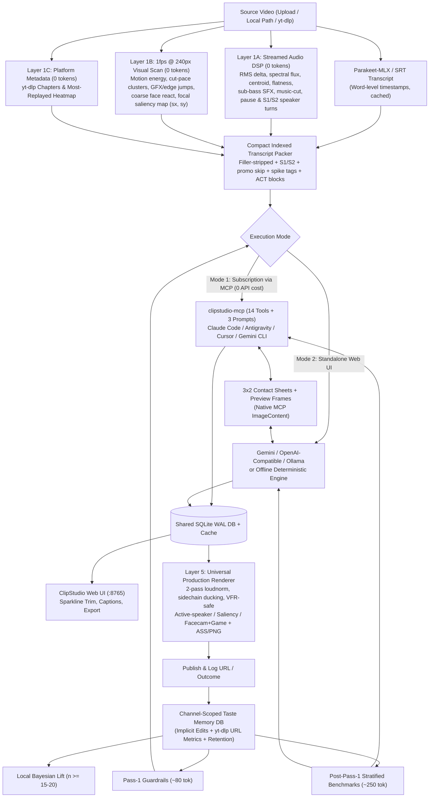

# ClipStudio — Universal LLM-First Multimodal & MCP-Native Upgrade Plan

> **Status:** Complete Master Architecture & Reference Blueprint (Pre-Implementation)  
> **Scope:** Universal short-form video clipping across **all genres** — podcasts, interviews, video essays, documentaries, tutorials, product reviews, vlogs, comedy, sports, art/cinema, and gaming/livestreams — runnable **on your existing coding-agent subscription via MCP ($0 extra API cost)** or **standalone in the Web UI**.

---

## 1. Executive Summary & Dual-Mode Execution Model

### Why the Current Pipeline Leaves Quality on the Table

Today, ClipStudio uses a **heuristic-first, lexicon-gated** pipeline:
1. Rule-based phrase lexicons (`HOOK_PHRASES`, `CONTROVERSY_PHRASES`, `STORY_PHRASES`) + lexical TextTiling + 0.5 s RMS volume scan score every sentence window.
2. Only *after* clip candidates and boundaries are frozen can an optional local LLM rewrite titles/hooks and nudge the score by `±5` points.

This creates four structural ceilings:
- **Zero nuance comprehension:** Sarcasm, deadpan comedy, quiet emotional vulnerability, slow-burn setups, callbacks to earlier jokes, and subtle contrarian insights do not match keyword lists — so the LLM never even sees them.
- **Speech-only bias & rigid boundaries:** Dramatic pauses (`> 2.5 s`) and sparse-speech visual moments (art reveals, product B-roll, physical comedy, stunts) are penalized, and the LLM cannot shift boundaries to capture a pre-hook setup or post-speech payoff.
- **High wasted LLM overhead:** When enabled, `ollama.enrich()` fires serially per clip (`12×–30×` calls) with `keep_alive: 0` (reloading weights every call), repeats the full system prompt, lacks `num_predict` caps, has no disk cache, and silently discards valid outputs due to strict digit-vs-word number checks (e.g., `"22"` vs. `"twenty two"`).
- **No learning loop & no subscription-agent integration:** ClipStudio never learns from creator edits or post-publish performance, and requires separate Ollama or API keys instead of plugging cleanly into your existing **Claude Code / Antigravity / Cursor / Gemini CLI** subscription.

### Dual-Mode Architecture: MCP-First (Subscription-Native) + Standalone Web UI

Instead of fragile or ToS-restricted subprocess wrappers (`claude -p`), ClipStudio shares **one local engine, SQLite WAL database, `work_dir`, and React Web UI (`http://127.0.0.1:8765`)** across two seamless modes:

1. **Mode 1 — ClipStudio MCP Server (`clipstudio-mcp`, Primary for Subscription Users — $0 Extra API Cost):**
   - Runs as a local stdio MCP server (`python -m clipstudio.mcp_server`).
   - Your subscription agent (**Claude Code, Antigravity, Cursor, Gemini CLI, Claude Desktop**) acts as the Layer 2/3 intelligence — reading compact packed transcripts, inspecting 3×2 JPEG contact sheets and rendered preview frames via native MCP `ImageContent`, creating/editing/QA-ing/rendering clips, and logging real performance.
   - Because every clip is persisted in the shared SQLite DB, **clips appear live in the ClipStudio Web UI** for visual timeline trimming, caption styling, and ZIP export.
   - Aggressive token engineering (`~15k` tokens per 1-hour video instead of `~1.1M`) protects your **5-hour / weekly subscription usage caps**, letting you clip dozens of long videos per cycle.

2. **Mode 2 — Standalone Web UI Mode (Optional Direct Providers):**
   - Works without an agent attached using **Local Ollama** (batched with `keep_alive: "2m"` + single unload), **BYOK Cloud API** (Gemini / OpenAI-compatible with strict JSON schema + prefix caching), or the upgraded **Offline Deterministic Engine (`0` tokens)**.



---

## 2. Baseline Repository Audit Reference (Exact File & Line Map)

This section preserves every concrete bug, token waste source, and architectural bottleneck uncovered during the repository audit of `ClipStudio` (`gta_shorts`), serving as a permanent engineering checklist.

| Area | Exact Location | Issue / Bottleneck Identified | Planned Resolution |
|---|---|---|---|
| **LLM Reload & Prompt Waste** | `llm/ollama.py:51-61`, `jobs/pipeline.py:184-202` | Serial per-clip `enrich()` calls with `keep_alive: 0` cause 12×–30× cold model reloads, repeat the ~140-tok prompt every clip, lack `num_predict` caps, and have no disk cache. | Batched two-stage discovery/copy (or MCP agent loop), SHA-1 disk cache, `num_predict` caps, `keep_alive: "2m"` + single `keep_alive: 0` unload in `finally:`. |
| **Silent Token Discard** | `llm/ollama.py:73-86` | Strict digit-only `_numbers()` rejects `"22"` or `"$8"` when Parakeet transcribed `"twenty two"` / `"eight dollars"` — throwing away paid LLM output. | Shared `extract_numbers_normalized()` converting English number words & digits before grounding check (returns warnings in MCP `save_clips` so agent self-corrects). |
| **Post-LLM Rank Mismatch** | `jobs/pipeline.py:198-214` | LLM rating adjusts `total`, but clips are never re-sorted before assigning `rank` (Clip #2 can outscore Clip #1). | Re-sort strictly descending by final post-LLM score before DB insertion & `rank` assignment. |
| **`min_score` Bypass** | `analysis/highlights.py:94` | `if c.score.total < min_score and chosen: break` still forces 1 weak clip even if all candidates fail `min_score`. | Enforce `if c.score.total < min_score: break` strictly. |
| **Constant `visual` Score** | `analysis/scoring.py:157, 307` | `self.visual_base` depends solely on source video height (`1080p=85`, `720p=72`), giving 10% weight zero ranking signal. | Score per-window visual dynamics (`visual_energy`, cut pace, GFX/saliency) + mild resolution adjustment. |
| **O(N²) Analysis Loop** | `analysis/scoring.py:313-322`, `highlights.py:70-80` | Re-joins sentence strings and re-runs regex + stemming inside every candidate window (`O(N²)`). | O(1) prefix-sum arrays over `SentenceFeatures` + precomputed `frozenset` content tokens (`10–30×` faster). |
| **Lexicon & Penalty Bugs** | `analysis/lexicon.py:32-63`, `scoring.py:117-195` | Phrases (`"the truth is"`, `"hot take"`, `"honestly"`) triple-counted across `hook`, `emotion`, `category`; `DANGLING_STARTS` penalized twice (`-18` & `-22`); unweighted TextTiling (`segmentation.py:64-84`). | Deduplicate lexicons, single calibrated penalty + leading-filler trim, TF-IDF-weighted TextTiling. |
| **Hardcoded Language** | `transcription/parakeet_worker.py:73` | Hardcodes `"language": "en"` even when multilingual `parakeet-tdt-0.6b-v3` is selected. | Propagate detected `result.language` or `"multi"` for v3 / `"en"` for v2. |
| **Ignored Chunk Size** | `jobs/pipeline.py:124` | `transcription_chunk_seconds` setting is silently ignored in `balanced` and `high` modes. | Honor `settings.transcription_chunk_seconds` across all modes (with UI RAM warning if raised). |
| **Repeated Disk Reads** | `jobs/pipeline.py:292-296` | Batch rendering re-reads and JSON-parses the full `transcript.json` from disk for every clip. | Pass in-memory `Transcript` into `render_one()` / `render_spec()` / `clip_words()`. |
| **VFR Drift & Wasted Landmarks** | `media/reframe.py:75-86, 106` | `cv2.VideoCapture.set(CAP_PROP_POS_MSEC)` drifts on iPhone/OBS/ShadowPlay VFR footage; YuNet's 5 landmarks (`d[4:14]`) are discarded; no `FaceTrack` cache. | PTS-accurate/FFmpeg frame sampling for VFR safety, YuNet mouth-motion active-speaker tracking, `FaceTrack` disk cache. |
| **Audio/Video Render Flaws** | `media/render.py:78-79, 139-146`, `reframe.py:278` | Single-pass `loudnorm` causes start-of-clip volume pumping; flat music mix without ducking; no 25 ms edge micro-fades; CBR VideoToolbox `-b:v`; odd-pixel `sendcmd` crop offsets; Homebrew FFmpeg 8.x lacks `libass`. | Two-pass linear `loudnorm`, `sidechaincompress` ducking, 25 ms `afade`, VideoToolbox VBR `-q:v`, even `x & ~1, y & ~1`, automatic `libass` detection + RGBA PNG `concat`/`overlay` fallback. |
| **API & UI Bugs** | `api/system.py:92-96, 147-183`, `api/clips.py:146-148, 188-203`, `ProjectView.tsx:14-17` | Mode-preset auto-update is dead code; `/api/storage` redundantly `rglob("*")` walks `work/`; `upload_music` lacks streamed 200 MB cap & atomic `.part`; `preview-frame` ignores unsaved trim & tracking; `ProjectView` polls forever when idle; Re-process wipes edits without confirmation. | Apply mode presets only when `mode` changed; single-walk storage accounting; streamed cap + atomic `.part`; draft-aware tracked preview; stop idle polling; confirmation modal + manual clip + ZIP export. |

### Backward-Compatibility & Privacy Contract Guardrails
- **Localhost Ollama Privacy:** Keep `llm_url` strictly validated as localhost-only (preserving `tests/test_api.py:177`); use a separate `llm_base_url` field for OpenAI-compatible cloud endpoints, and mask `llm_api_key` in `GET /api/settings`.
- **Stable API Schema:** Preserve all 7 score criteria keys (`{"hook", "context", "emotion", "value", "story", "visual", "audio"}`) in clip `analysis.scores` (preserving `tests/test_api.py:123`).
- **Caption Preset Defaults:** Keep `strip_punctuation: bool = False` by default in `PRESETS["bold"]` (preserving `tests/test_media.py:20`), exposing stripping as a toggle/override.

---

## 3. Honest Technical Evaluation: Spectral Patterns & Author-Intent Detection

Before writing code, it is worth being completely candid about where **spectral audio patterns** and **editorial attention cues** genuinely improve universal clipping — and where they break down.

### A. What Genuinely Works Across All Video Genres (High ROI, 0 Tokens)

1. **Editorial Audio Fingerprints (Where the Original Editor Directed Attention)**
   Editors across YouTube essays, documentaries, podcasts, tutorials, and reviews use consistent audio grammar to say *"pay attention right here"*:
   - **`[MUSIC_CUT]` (Background Bed Drop):** Many edited videos run a subtle harmonic music bed underneath narration and **abruptly mute it** right before a major reveal, punchline, or thesis statement. Locally, a sudden drop in steady low-mid harmonic floor (`100–600 Hz`) while speech continues or pauses is cheap to detect via streamed FFT.
   - **`[SFX_STING]` (Sub-Bass Impact / Whoosh / Chime):** Transition risers, bass drops (`< 120 Hz` transient spike), and UI pop/chime stings (`2–7 kHz` sharp spectral flux spike over `< 1 s`) mark visual reveals, chapter pivots, and key takeaways.
   - **`[DRAMATIC_PAUSE]` (0.8–2.5 s Intentional Beat):** A clean silence beat right before or after a dense statement signals a punchline or mic-drop moment. *(Today, ClipStudio blindly penalizes pauses `> 2.5 s` via `-6 * gaps`.)*
   - **`[LAUGH_BURST]` / `[AUDIO_SPIKE]`:** Combined RMS jump + spectral flux + mid-high excitation catches genuine audience/host laughter, applause, gasps, and sudden excitement without confusing them with steady loud music.

2. **Vocal Prosody, Delivery Shifts & Speaker Turns (Works Even Without Any Editing)**
   - **Brightness & Intensity Shifts:** Tracking **spectral centroid** (vocal brightness/strain) and **speaking-rate variance** relative to a local baseline catches moments when a calm speaker suddenly leans in, lowers their voice for emphasis, or speaks rapidly with passion — even in unedited 1-camera podcasts or lectures.
   - **Speaker-Change Markers (`S1|` / `S2|`):** Lightweight MFCC cosine clustering on voiced sentences (`numpy`/`scipy`, ~15 MB RAM, 0 tokens) marks speaker turns so the LLM distinguishes a monologue from a sharp 2-person debate, roast, or interview interruption.

3. **Editorial Visual Fingerprints (Where the Author/Camera Directed Attention)**
   - **`[EDIT_PACE++]` / `[PUNCH_IN]`:** Rapid cut clusters (multiple HSV histogram shifts within 4–6 s) or sudden framing punch-ins indicate high-retention editorial emphasis.
   - **`[GFX_OVERLAY]`:** A sudden jump in spatial edge density / high-contrast rectangular regions signals a pop-up chart, B-roll graphic, artwork close-up, code block, or on-screen text card that the creator took time to illustrate.
   - **`[VIS_MOTION++]`:** Frame-to-frame pixel/motion energy highlights physical demonstrations, sports plays, art transformations, and gaming action.
   - **Spatial Focal Saliency `(sx, sy)`:** Tracking where motion + edge contrast concentrate in each frame lets the reframer crop onto an artwork, whiteboard, product demo, or subject even when **zero faces** are on screen.

4. **Platform Author & Audience Signals (Free from `yt-dlp`)**
   - **`[CHAPTER: ...]`:** Creators explicitly label topic transitions via video chapters. Passing chapter headers inline gives the LLM instant structural context at near-zero token cost.
   - **`[REPLAY_PEAK]`:** YouTube's `heatmap` ("Most Replayed") data directly reveals which timestamps real viewers rewound to watch again.

### B. Honest Limitations & Anti-Patterns (And How This Plan Mitigates Them)

| Risk / Limitation | Why It Happens | Architectural Safeguard |
|---|---|---|
| **Deadpan / calm brilliance has no spectral spike** | A dry comedic aside, subtle roast, or quiet philosophical insight looks acoustically flat. | Signals are **additive hints for the LLM, NEVER hard filters**. The LLM still reads every sentence of the transcript. |
| **Over-compressed podcasts & loud music beds** | Heavy studio compression or continuous EDM makes global dB/flux thresholds fire constantly. | **Local sliding-window normalization (25 s window):** emit tags only on strong **local** anomalies (e.g., `z > 1.8` and top N% of the video). |
| **Raw, unedited recordings have zero editorial SFX/cuts** | Zoom calls, raw lectures, or plain livestreams have no `[MUSIC_CUT]` or `[GFX_OVERLAY]`. | All detectors are **relative and optional**; if no spikes fire, the LLM cleanly selects purely on transcript nuance and conversational flow. |
| **Token explosion if raw telemetry is sent to LLM** | Sending per-0.5 s arrays of FFT/motion numbers for 1 hour would add 30k+ useless tokens. | **Local distillation only:** DSP/CV collapses into sparse inline tags (`[MUSIC_CUT]`, `[A++]`, `[V++]`) on spike lines only (~200–400 extra tokens per hour). |
| **Spectral signals cannot verify visual aesthetics** | An editor's music cut tells you *when* something happens, not *whether* the frame actually looks good vertically. | **Layer 3 Contact-Sheet Vision** verifies actual visual aesthetics, legibility, and framing on the top shortlisted candidates. |

---

## 4. ClipStudio MCP Server Specification (`clipstudio-mcp`)

To let **Claude Code, Antigravity, Cursor, Gemini CLI, and Claude Desktop** drive every ClipStudio upgrade natively on your existing subscription, `backend/clipstudio/mcp_server.py` exposes a complete, token-safe stdio MCP server sharing `AppContext` (SQLite WAL + `work_dir` + `cache/`).

### A. Transport, Shared State & 8 GB RAM Concurrency Safety
- **Transport:** Standard MCP over `stdio` (`uv run --directory /path/to/gta_shorts/backend python -m clipstudio.mcp_server`), using the official `mcp` Python SDK (`FastMCP`).
- **Live UI Sync & RAM Guard:** Shares the exact same `clipstudio.db` (SQLite WAL) and `data/` directory as the FastAPI Web UI. Heavy operations (`ingest_and_scan`, `render_clips`) acquire an advisory SQLite/process lock (or enqueue onto the worker if the web server is running) so **only one heavy ML/FFmpeg job runs at a time** on an 8 GB Mac.

### B. Complete MCP Tool Surface (14 Tools — Full Parity with Every Upgrade)

| Category | Tool Name | What It Does & Token-Efficiency Design |
|---|---|---|
| **Ingest & State** | `list_projects(limit, status?, channel_id?)` | Lists projects with status, duration, channel, clip counts, and disk usage. |
| | `ingest_and_scan(source, channel_id?, content_profile?, focus_directive?, allow_srt_fastpath?)` | Accepts local path or public URL (`yt-dlp` + chapters/heatmap). Runs Parakeet-MLX (or `.srt` fast-path) + Audio DSP + `S1\|S2` speaker turns + 1 fps Visual/Saliency scan locally (**0 subscription tokens**). Returns `project_id`, `chunk_count`, signal summary, chapters, and estimated packed tokens. |
| | `get_project_status(project_id)` | Stage progress, storage/free-space check, `libass` availability (`native` vs `png_overlay`). |
| **Discovery & Vision** | `get_packed_transcript(project_id, chunk_index=0, chunk_minutes=30, skip_promos=True, include_signals=True, include_guardrails=True)` | Returns the **Compact Indexed Transcript** (`idx\|sec\|S1\|text [TAGS]`), `[ACT]` blocks, `[CHAPTER]` headers, promo skips, and unbiased Pass-1 channel guardrails (~80 tok). Never dumps raw word JSON. |
| | `search_transcript(project_id, query, context_sentences=3)` | Targeted regex/keyword search returning compact matching snippets (`~200` tokens) for follow-up queries on multi-hour VODs. |
| | `get_signal_peaks(project_id, kinds?, top_k=15)` | Returns top `[MUSIC_CUT]`, `[GFX_OVERLAY]`, `[REPLAY_PEAK]`, `[LAUGH_BURST]`, `[ACT]` peaks with 1-line surrounding text for ultra-fast scanning of 3–6 hr streams. |
| | `get_contact_sheets(project_id, candidates, include_benchmarks=True)` | Generates 3×2 JPEG contact sheets (`960×540`) for the shortlisted candidates and returns them as **native MCP `ImageContent`** + **Tier-2 Stratified Channel Winner/Flop Benchmark cards** (strictly post-Pass-1!). |
| **Editing, QA & Render** | `save_clips(project_id, clips, replace_existing=False)` | Accepts index-only `s0..s1` / `t0..t1` / `teaser_s`, snaps to exact Parakeet word timestamps (auto-trimming leading vocal fillers), runs normalized-number grounding validation (returning structured warnings if ungrounded so the agent can fix without wasting a full re-run), saves `analysis.patterns`. Appends non-destructively by default (`replace_existing=False`). |
| | `edit_clip(clip_id, start?, end?, title?, hook?, description?, hashtags?, status?, layout?, aspect_ratio?, caption_preset?, caption_style?, hook_banner?, auto_tighten?, teaser_s?, music_path?, music_volume?)` | Full parity with every `ClipEditor` control in the Web UI (trim, metadata, framing `track/split/facecam/saliency/blur/center`, caption style, hook banner, jump-cut pacing, music). |
| | `preview_clip_frame(clip_id, t?, draft_overrides?)` | Renders one frame with exact crop (`track`/`saliency`/`facecam`/`blur`), captions (ASS or PNG fallback), and optional Hook Banner, returning it as **native MCP `ImageContent`** so the agent can visually QA framing & caption readability before rendering! |
| | `render_clips(project_id?, clip_ids?, output_height?, encoder?)` | Runs full broadcast render (2-pass linear `loudnorm`, `sidechaincompress` music ducking, 25 ms micro-fades, cached `FaceTrack`/`saliency`, ASS/PNG captions) and returns output paths + `layout_used` + `face_ratio`. |
| **Export & Memory** | `export_approved(project_id, dest_dir?, scope="approved", format="zip|folder")` | Bundles rendered MP4s + `.txt` metadata sidecars (title, hook, description, hashtags, score, timestamps). |
| | `log_clip_performance(clip_id, outcome?, published_url?, views?, stayed_to_watch_pct?, avg_view_pct?, likes?, comments?, shares?, saves?, notes?)` | Supports 1-click outcome (`winner\|normal\|underperformed`), **`yt-dlp` auto-fetch of `views/likes/comments` from `published_url`**, or manual/CSV retention metrics. |
| | `get_channel_memory(channel_id, refresh_urls=False)` | Returns channel-scoped Creator Playbook, implicit edit learnings (trim deltas, preferred duration), Tier-2 Winner/Flop benchmarks, and Performance Insights (optionally refreshing `published_url` metrics via `yt-dlp`). |

### C. Built-In MCP Prompts & Resources

- **MCP Prompts (Reusable Agent Workflows):**
  1. `clipstudio/clip_video`: Canonical 4-step workflow (`ingest_and_scan` → `get_packed_transcript` → `get_contact_sheets` + Tier-2 benchmarks → `save_clips` with `80/20` exploration rule + `preview_clip_frame` QA + optional `render_clips`).
  2. `clipstudio/find_more_clips`: Non-destructive follow-up (`search_transcript` / `get_signal_peaks` → `save_clips(..., replace_existing=False)`).
  3. `clipstudio/review_performance`: Pulls `get_channel_memory(refresh_urls=True)` and reports what hooks, durations, and framing are winning vs. losing on that channel.
- **MCP Resources (Zero-Cost Read Context):**
  - `clipstudio://channels` (channel profiles & sample counts)
  - `clipstudio://presets/captions` (6 caption presets + style schema)
  - `clipstudio://settings` (non-secret app settings)
  - `clipstudio://system` (RAM, disk free, `ffmpeg`/`libass` status)

### D. Ready-to-Use MCP Client Config (Claude Code / Antigravity / Cursor / Claude Desktop)

```json
{
  "mcpServers": {
    "clipstudio": {
      "command": "uv",
      "args": [
        "--directory",
        "/path/to/gta_shorts/backend",
        "run",
        "python",
        "-m",
        "clipstudio.mcp_server"
      ]
    }
  }
}
```

### E. How Every Upgraded Feature Works Across Both Modes

| Upgrade Feature | In MCP Mode (Subscription Agent) | In Standalone Web UI Mode |
|---|---|---|
| **Spectral & 1 fps Visual Signals** | Emitted inline in `get_packed_transcript` & `get_signal_peaks` | Emitted inline in packed prompt + offline `Scorer` |
| **3×2 Contact-Sheet Vision** | Returned as native MCP `ImageContent` via `get_contact_sheets` | Sent in 1 batched multimodal call via `llm/provider.py` |
| **Visual QA Before Render** | Agent calls `preview_clip_frame` -> inspects `ImageContent` | User clicks **Preview captions** in `ClipEditor.tsx` |
| **Channel Taste Memory** | Pass-1 guardrails in `get_packed_transcript`; Tier-2 cards in `get_contact_sheets` | Same Tier-1 & Tier-2 injection inside `llm/discover.py` |
| **Interactive Follow-Ups** | Chat naturally with agent (`search_transcript` + `save_clips`) | "Find 5 more clips about..." input using prefix cache |

---

## 5. Detailed 5-Layer Pipeline Specification

### Layer 1 — Local Multimodal, Speaker & Editorial Signal Extraction (`0` Tokens, `< 60 MB` RAM)

1. **Streamed Audio DSP & Speaker Turns (`analysis/audio_features.py`):**
   - Streams 16 kHz mono WAV in 0.5 s hops (`np.fft.rfft`, constant memory): `db`, `peak`, `flux` (positive spectral flux), `centroid` (Hz), `flatness` (Wiener entropy), `sub_bass` (`< 120 Hz`), `hf_ratio` (`2–7 kHz`).
   - Local 25 s sliding-median/MAD event detectors: `[MUSIC_CUT]`, `[SFX_STING]`, `[LAUGH_BURST]`, `[AUDIO_SPIKE]`, `[DRAMATIC_PAUSE]` (`0.8–2.5 s`).
   - Lightweight MFCC cosine clustering (`numpy`/`scipy`, ~15 MB RAM, 0 extra models) emits `S1|`/`S2|` speaker-turn tags on voiced sentences.
   - Backward-compatible `AudioProfile.load()` defaults missing new arrays cleanly.

2. **Streamed Visual & Editorial Scanner (`media/visual_scan.py` — *NEW*):**
   - Single OpenCV pass at **1 fps, 240 px** (~30 MB RAM): `motion`, `cut_density` (`[EDIT_PACE++]`), `gfx_jump` (`[GFX_OVERLAY]`), coarse YuNet face presence (`[FACE_REACT]`), and normalized spatial saliency centroid `(sx, sy)`. Cached to `cache/visual_<fp>.json`.

3. **Speechless `[ACT]` Blocks & `yt-dlp` Metadata (`media/download.py`):**
   - Non-speech stretches `≥ 4.0 s` with high local visual/audio spikes become `[ACT t0-t1 | V++ A++ GFX]` timeline blocks.
   - Captures free `chapters` and YouTube `heatmap` (`[REPLAY_PEAK]`) during `inspect()`/`download()`.

---

### Layer 2 — Compact Indexed Transcript & Full-Transcript Discovery

#### Token-Dense Wire Format (`llm/transcript_pack.py` — *NEW*)
```text
META: dur=3420s channel="TechEssays" dir="prioritize surprising insights and visual reveals"
[GUARDRAIL: Prefer 25-45s clips; avoid slow 10s+ throat-clearing intros]
[CH 0:00 Intro]
0|4|S1|Most people think color grading is about LUTs.
1|9|S1|Wait until you see what happens when we invert the shadows. [GFX_OVERLAY]
2|14|S1|Look at the skin tones right here—completely broken. [MUSIC_CUT][PUNCH_IN]
[ACT 17-24 | V++ GFX | visual transformation reveal]
[SKIP 120-185 promo]
[CH 4:50 The Real Mistake]
40|290|S1|Everyone told me this lens was garbage. [REPLAY_PEAK]
41|295|S2|Wait, really? Even the 35mm prime?
42|299|S1|For six months I believed them—then I shot this night scene at F1.4. [DRAMATIC_PAUSE][A+]
```
- Strips fillers (`um`, `uh`, `you know`), collapses sponsor/ad reads (`[SKIP ... promo]`), encodes speaker turns (`S1|`/`S2|`), and attaches spike tags only on anomalies (`~50–65%` fewer input tokens).
- Videos `≤ 45 min` fit in **1 pass**; `> 45 min` use **30-min chunks with 2-min overlaps** + cross-chunk merge.
- Index-only JSON output (`s0, s1, t0, t1, teaser_s, sc, cat, hook_type, why, nv, lay`) snaps cleanly to Parakeet word timestamps with leading vocal-filler trimming.

---

### Layer 3 — Targeted Contact-Sheet Vision Verification (`media/contact_sheet.py` — *NEW*)

- Extracts **6 key frames** per shortlisted candidate (`t0`, `t0 + 2s`, peak activity, midpoint, `t1 - 1s`, `t1 + 3s` post-speech buffer) stamped with timestamps into **one `960×540` 3×2 JPEG** (~35–45 KB).
- In **1 batched multimodal step** (via MCP `ImageContent` or standalone provider):
  1. Verifies **0–2 s visual hook** (drops/demotes menus, loading screens, static clutter).
  2. Applies **visual boundary polish** (`dt0`, `dt1` in `-3..+4 s` to catch post-speech visual payoffs).
  3. Picks **per-clip framing** (`track`, `split`, `facecam`, `saliency`, `blur`, `center`) and `thumb_t`.
  4. Generates **visual+transcript grounded copy** validated with `extract_numbers_normalized()`.

---

### Layer 4 — Channel-Scoped Creator Taste Memory & Real-Performance Loop (Corrected Design)

Designed to avoid manual-entry friction, noisy-view overfitting, and cross-genre contamination:

1. **Per-Channel / Per-Niche Isolation (`channels` DB table + `channel_id`):**
   - Every project belongs to a channel/niche (e.g., *"Podcast"*, *"Gaming"*, *"Tech Essays"*). Metrics, Playbooks, and Winner/Flop benchmarks never leak across genres.

2. **Zero-Friction Implicit Loop First (Works Day 1):**
   - Automatically records `approved`/`rejected`, **trim deltas** (e.g., *"creator trims 2.8 s off openings"*), preferred duration distribution, and hook edits — zero manual typing required.

3. **Ultra-Low-Friction Explicit Performance Capture (`clip_metrics` table):**
   - **1-Click Outcome Pill:** `Winner` / `Normal` / `Underperformed`.
   - **Published URL Auto-Fetch (`yt-dlp`):** Paste your uploaded YouTube Short / TikTok / Reel URL and ClipStudio automatically pulls public `views`, `likes`, and `comments` (plus `refresh_urls` via MCP or Web UI).
   - **Optional Retention / Studio CSV Import:** Accepts `stayed_to_watch_pct`, `avg_view_pct`, `shares`, `saves` manually or via bulk CSV/JSON import.

4. **Metric Decoupling & Honest Statistical Gates (`analysis/memory.py` — *NEW*):**
   - Separates signals cleanly instead of conflating viral topic luck with editing patterns:
     - `stayed_to_watch_pct` → **Hook & 0–2 s visual grab** (cleanest signal).
     - `avg_view_pct` → **Pacing, narrative arc & duration** (cleanest signal).
     - `(shares + saves) / views` → **Resonance**.
     - Raw `views` → Normalized via channel median (`log10`) and **down-weighted** whenever retention metrics exist.
   - **Selection-bias guard:** Never auto-labels a clip `"FLOP"` from relative median unless **`n ≥ 10` AND `views < 0.4 × median`** (or explicitly marked `underperformed`/`rejected`).
   - **Two-threshold activation:**
     - **`n ≥ 5` clips:** Qualitative LLM benchmark calibration turns on (the LLM understands *why* a clip worked structurally).
     - **`n ≥ 15–20` clips:** Automated local Bayesian numeric weight updates (`CALIBRATION()`) activate with 90-day recency decay.

5. **Unbiased Pass 1 + Strictly Post-Pass-1 Stratified Benchmark Calibration (`80/20` Rule):**
   - **Pass 1 (Tier 1, `~80` tokens):** Kept unbiased — injects only minimal structural guardrails (preferred duration, consistent trim-start habit, explicit dislikes) so fresh ideas are never suppressed.
   - **Post-Pass-1 (Tier 2, `~250` tokens, bundled into Layer 3 / `get_contact_sheets` with `0` extra calls):** Injects **stratified examples** (`1 recent winner`, `1 highest-retention winner`, `1 recent approved favorite`, `1 clear underperformer/rejected`) with the explicit rule: *"Calibrate on structural hook craft and pacing — NOT topic."*
   - **`80/20` Exploration Reserve + Bypass Toggle:** Reserves ≥ 20% of slots (`1–2` clips) for novel exploratory picks, plus a one-click *"Ignore channel memory for this video"* toggle.

---

### Layer 5 — Token Cost Engineering, Production Media & UX Polish

#### Estimated Token / Subscription Quota Usage (1-Hour Video, ~9,000 Words, 10 Final Clips)

| Pipeline Stage | Naive Full-Video Approach | Planned Architecture | Savings |
|---|---|---|---|
| **Transcript Input** | Raw JSON (`~150,000 tok`) | Compact indexed + `S1/S2` + promo skip (`~10,150 tok`) | **~93%** |
| **Channel Memory (Tier 1 + 2)** | Full history dump (`~5,000+ tok`) | Minimal Pass-1 guardrails + 4 stratified cards (`~330 tok`) | **~93%** |
| **Visual Input** | 1 fps full video (`~930,000 tok`) | 3×2 contact sheets on top 8 clips (`~2,200 tok`) | **~99.7%** |
| **Output Tokens** | Echoed text + copy × 20 (`~12,000 tok`) | Index-only discovery + batched winner copy (`~2,200 tok`) | **~82%** |
| **Re-runs / Follow-ups** | Full re-bill every run | SHA-1 disk cache + prefix cache | **75–100%** |
| **Total per 1-hr Video** | **~1,097,000 tokens** | **~14,880 tokens (`0` extra `$` via MCP; `~$0.005–$0.02` BYOK)** | **~98.6%** |

#### Production Media, Universal Reframing & Creator Workflow Upgrades
- **Audio (`media/render.py`):** Two-pass linear `loudnorm` (`-14 LUFS`, `-1.5 dBTP`), `sidechaincompress` music ducking, 25 ms `afade` edge micro-fades.
- **Universal VFR-Safe Reframing (`media/reframe.py`):** PTS-accurate / VFR-safe frame extraction, YuNet 5-landmark mouth-motion active-speaker tracking, **`saliency`** focal-point crop (zero-face videos), **`facecam`** 35/65 split layout, `FaceTrack` disk cache, even-pixel `sendcmd`, VideoToolbox VBR (`-q:v` with `-b:v` fallback).
- **Captions & Homebrew FFmpeg 8.x Compatibility (`media/ffmpeg.py`, `media/captions.py`):** `ff.has_filter("ass")` check + built-in OpenCV BGRA PNG `concat`+`overlay` fallback when `libass` is absent; optional 2.5 s Hook Banner; Shorts/Reels/TikTok safe zones; strip-punctuation toggle; `paginate()` overlap guard.
- **Standalone Provider Resilience (`llm/provider.py`):** Gemini/OpenAI strict JSON schema, `429`/`503` exponential backoff, SHA-1 disk cache, `TokenBudget` cap, pre-run token/cost estimator.
- **Creator Web UI (`frontend/src/*`):** Channel selector, Audio+Visual activity sparkline on the trim timeline, stop idle polling, Re-process confirmation modal, **+ Manual Clip**, **Export Approved (.zip)** with `.txt` sidecars, follow-up query bar, 1-click Outcome + Published URL metric logger + **Performance Insights** card.

---

## 6. Optional Pro Retention & Multilingual Upgrades (Phase 5 — Modular Toggles)

1. **Cold-Open Teaser Splice:** `teaser_s` prepends a punchy 2–3 s climax clip at `t = 0` (`0` extra tokens; toggleable per clip).
2. **Auto-Tighten Pacing (Dead-Air Jump-Cut Toggle):** Optional per-clip render toggle compressing silences `> 0.9 s` to `0.25 s` using Parakeet word timestamps (off by default to protect dramatic pauses).
3. **SRT / Subtitle Fast-Path & Full Multilingual Support:** Import `.srt` or `yt-dlp` captions alongside Parakeet v3 (25 languages) with zero English lexicon lock-in.

---

## 7. Phased Implementation Roadmap & File Map

| Phase | Goal | Target Files |
|---|---|---|
| **Phase 0** | Clean baseline, FFmpeg 8.x `libass` PNG fallback & core bugs | `media/ffmpeg.py`, `media/captions.py`, `media/render.py`, `transcription/parakeet_worker.py` |
| **Phase 1** | Zero-token spectral, `S1\|S2` speaker-turn, 1 fps visual/saliency scanners, `yt-dlp` chapters/heatmap & O(1) offline scorer | `analysis/audio_features.py`, *new* `media/visual_scan.py`, `media/download.py`, `analysis/lexicon.py`, `analysis/segmentation.py`, `analysis/scoring.py`, `analysis/highlights.py` |
| **Phase 2** | Compact indexed packer + **ClipStudio MCP Server (`clipstudio-mcp`)** + standalone provider/cache/budget layer | *new* `llm/transcript_pack.py`, *new* `mcp_server.py`, `llm/provider.py`, *new* `llm/discover.py`, `llm/ollama.py`, `config.py` |
| **Phase 3** | Targeted 3×2 contact sheets + Channel-Scoped Taste Memory (`clip_metrics`, `yt-dlp` URL metrics, Tier 1+2) + pipeline wiring | *new* `media/contact_sheet.py`, *new* `analysis/memory.py`, `db.py`, `jobs/pipeline.py` |
| **Phase 4** | VFR-safe reframing (`saliency`, active-speaker, `facecam`), 2-pass `loudnorm`, music ducking, Web UI sparkline/metrics/export/polling fixes | `media/reframe.py`, `media/render.py`, `api/system.py`, `api/clips.py`, `api/projects.py`, `api/schemas.py`, `frontend/src/*` |
| **Phase 5** | Optional pro retention & multilingual toggles | Cold-open `teaser_s`, auto-tighten jump-cut toggle, `.srt` fast-path ingest |

---

## 8. Verification & Quality Evaluation Strategy

### Automated Test Suite
- **`tests/test_signals.py`** *(new)*: Streamed spectral flux/centroid/flatness/sub-bass, local-baseline music-cut & dramatic-pause detectors, `S1|S2` speaker-turn clustering, 1 fps visual motion/cut/GFX/saliency scanner, and `[ACT]` block generation.
- **`tests/test_llm_discovery.py`** *(new)*: Compact transcript packing (`> 50%` reduction), promo collapsing, index-to-word-timestamp snapping, mocked Gemini/OpenAI/Ollama strict-schema discovery + overlap dedup, SHA-1 disk cache hit (`0` HTTP calls), `429`/`503` backoff, token budget guard, normalized-number grounding (`"twenty two"` ↔ `"22"`), and post-LLM rank re-sorting.
- **`tests/test_mcp.py`** *(new)*: Stdio MCP server registration (14 tools + 3 prompts + 4 resources), `ingest_and_scan`, `get_packed_transcript`, `get_contact_sheets` `ImageContent`, `save_clips` grounding warnings + non-destructive append, `preview_clip_frame` `ImageContent`, `edit_clip`, `log_clip_performance` URL auto-fetch mock, and `get_channel_memory` channel isolation.
- **`tests/test_vision_contact_sheet.py`** *(new)*: 3×2 JPEG contact-sheet generation (`960×540`), timestamp stamping, and mocked visual boundary/layout calibration.
- **`tests/test_memory.py`** *(new)*: Channel isolation, implicit trim-delta tracking, `yt-dlp` URL metric fetch mock, selection-bias flop gate (`n >= 10` & `< 0.4x`), two-threshold activation (`n >= 5` benchmarks, `n >= 15` Bayesian lift), and `80/20` exploration slot preservation.
- **`tests/test_analysis.py`, `tests/test_media.py` & `tests/test_api.py`**: O(1) prefix-sum scorer parity & `< 1 s` benchmark, strict `min_score`, two-pass `loudnorm`, `sidechaincompress`, `saliency` & `facecam` reframing, VFR-safe seeking, YuNet mouth-motion active speaker, `FaceTrack` cache, PNG caption overlay fallback when `libass` is absent, `upload_music` >200 MB rejection, API key masking, manual clip creation, and approved ZIP export.
- **Commands:**
  ```bash
  cd backend && uv run --group dev pytest -m "not slow" -v
  cd frontend && npx tsc --noEmit && npm run build
  ```

### Real-World Multi-Genre Quality Benchmark
Evaluate before/after across **4 distinct 30–60 min test videos**:
1. **Podcast / Multi-Person Interview** — `S1|S2` turns, active-speaker tracking, conversational nuance, pause tolerance.
2. **Edited Video Essay / Documentary** — `[MUSIC_CUT]`, `[GFX_OVERLAY]`, `[PUNCH_IN]`, `saliency` reframing.
3. **Visual Tutorial / Art / Product Review** — speechless `[ACT]` reveals, contact-sheet visual hook rejection, text/artwork legibility.
4. **Gaming / Livestream VOD** — audio/motion peak alignment, `facecam` + gameplay split, noisy background normalization.

**Success Metrics:**
- Total LLM usage per 1-hour video: **≤ 18k tokens (`$0` extra via MCP subscription; `< $0.02` BYOK Flash)** with **0 tokens** on re-renders and **75–90% savings** on follow-up queries.
- Measurable lift in `stayed_to_watch_pct`, `avg_view_pct`, and creator approval rate once ≥ 5–15 clips are recorded per channel.
- Zero render failures on macOS regardless of whether `libass` is compiled into FFmpeg.
